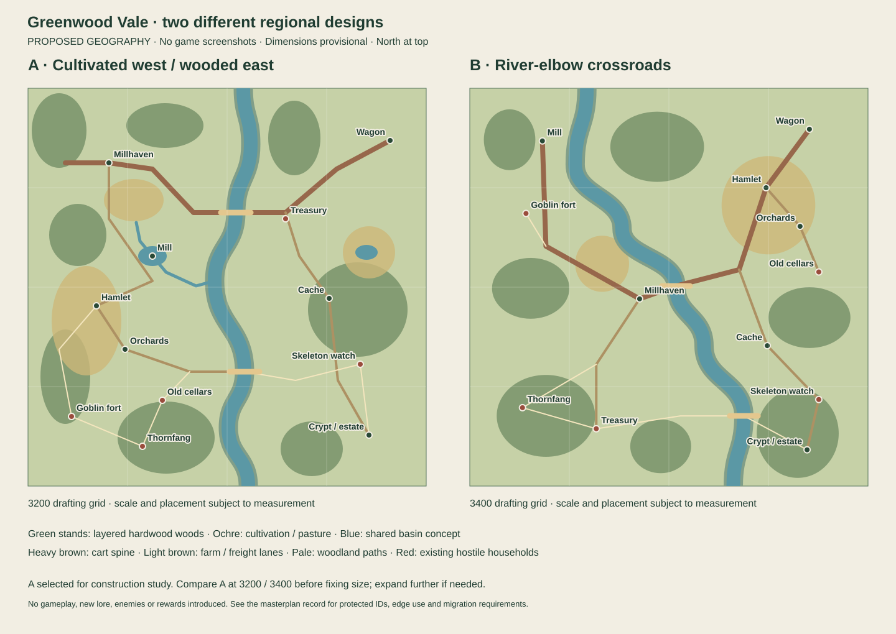

# Greenwood Vale — regional design comparison

**29 October 2026 · dev.237 implemented on draft #654 · Execution-quality audit in progress · Unmerged/unpublished**

Authority: [restart commission on draft #644](https://github.com/joedoragon-glitch/azeroth-chronicles-prototype/pull/644), [50 owner decisions](GREENWOOD_VALE_OWNER_ART_DIRECTION_DECISIONS_20261028.md), [epic #545](https://github.com/joedoragon-glitch/azeroth-chronicles-prototype/issues/545). This record contains distinct design evidence, not another release ledger. The five original documents remain historical references. The alternatives preserve the design rationale; the selected 3200 implementation is now playable on the draft. Historical study receipts below describe their recorded revisions, not the current candidate.

## Fresh reality audit

The implementation base is **main@fcc1f42**, containing the Greenwood-only dev.235 rollback after the rejected dev.233 release. **The rollback undoes the rejected work; it does not set the replacement's dimensions.** The owner reconfirmed that 3200 was reasonable in size, is not a ceiling, and must itself be reassessed for the new design. The commission was prepared on earlier main@bda30dab. Its statement that dev.233 remains the current source is therefore historical. Publication of the rollback must be verified separately; a local checkout does not prove publication. Other-region rollback drafts #649/#651 are separate work and are not incorporated here.

The five unmodified owner iPhone screenshots were recovered and inspected. They show broad angular traffic loops, scattered services, an isolated pond/wheel, fragmented Goblin fencing and an unconvincing Treasury bridge defense. They are rejection evidence, not replacement designs. Their private ZIP is not copied into the public repository.

The current source still has **32 ordinary outdoor actors, six regional quests and 640 finite outdoor crowns**. The original river is a narrow near-straight divider around x=1200; crossing centers are y=750/1750. Two independent circular water obstacles occupy the west/east. The runtime's actual Hamlet service is near (240,1420), not the declared (900,700) anchor. Source tables alone therefore cannot establish the realized scene.

`world.js` constructs roads from navigation-grid paths, then performs multiple settlement, clearance, environment and onboarding passes. `greenwood.js`'s rejected scene searched for individual prop positions after this generation. `visuals.js` gives roads shared breadth. These are source-confirmed causes that can produce disconnected composition. Navigation and collision remain authoritative, but **the replacement visible road hierarchy must be authored first**. Art and defenses must belong to deliberate district parcels.

The Marches benchmark uses an irregular shared water boundary, relocated complete districts and meaningful coastal edges. Highlands uses a shared winding river, complete relocation groups, seven deliberately varied trees, coherent ore/mint industry and doorstep routes. Frontier separates perimeter, gate, yard, service and supply functions. Greenwood needs comparable scope with its own green summer identity.

## Two complete alternatives

Both plans retain the same identities and encounter/reward totals. Neither derives its river or street positions by stretching the old map. The drawings are **geographic design diagrams**, not game screenshots or collision acceptance.

| Relationship | A — cultivated west / wooded east, 3200 | B — river-elbow crossroads, 3400 |
| --- | --- | --- |
| Basin | A broad S-bend river flows north to south through the eastern half; a western tributary feeds the mill before joining it | River swings from the northwest across the center into the southeast; town occupies an inside elbow |
| Newcomer | Millhaven on a northwest terrace, short visible civic street and southern farm exit | Central riverside Millhaven, with crossing traffic prominent immediately |
| Production | Quieter western Hamlet; orchards and small fields surround its southern freight lane; mill on the northern production edge | Orchard village northeast, on the opposite bank; northwest mill ships through town |
| Crossings | Northern freight bridge serves town/Treasury/wagon; narrower southern bridge completes farm–woods–estate circuit | Central cart bridge and far southeast footbridge create a longer diagonal circuit |
| Hostile households | Southwest Goblin roadside fort off the farm lane; separate occupied old cellar; east-bank Skeleton watch; Thornfang in southern woods | Goblin toll compound northwest near incoming river; Skeleton watch far east; Thornfang southwest; old cellar northeast beyond cultivated village |
| Reclamation | Southeast Crypt/estate → east-bank cache → northern Treasury receiving yard → bridge/wagon | Southeast Crypt → central-east cache → southwest Treasury; crosses the civilian street to reach transport |
| Edges | Northwest managed woodland/smallholds; northeast wagon receiving edge; southeast estate works; southwest domestic Goblin/woodland approach | Northwest hydraulic/hostile approaches; northeast fruit production; southeast estate/footbridge; southwest Treasury/den |
| Migration | Stable district translation plus source-version adapters for original, expanded and rolled-back saves | More frequent bank changes and civilian/hostile swaps require more saved-object relocation |
| Risk | Longer west-bank production circuit; avoid exposing Hamlet to the southern den and cellar groups | Early transport hostility and diagonal supply traffic cut through the newcomer center; larger quiet intervals with unchanged 32 actors |

**Engineering selection: A's regional relationships for construction and measurement; dimensions remain provisional.** Its separated production and reclamation corridors give the six existing quests distinct journeys, retain a quiet welcoming opening, and use every corner without routing industrial/hostile traffic through the town center. This is a design rationale, **not a fabricated route-performance result**. Compare the selected topology at **3200 and 3400**, and extend further if complete parcels, sightlines, hydraulic works and companion-safe routes require it. Comparing A at 3200 against B at 3400 alone would confound map design with size. Reassess usable land, actual camera composition, encounter gaps, migration fit and route cost before fixing dimensions; neither the rollback nor the rejected release sets a numerical limit. Reopen the topology selection if those checks fail.

## Selected plan: parcels, routes and land use

| District / stable identities | Target center | Required parcel and connection |
| --- | --- | --- |
| Millhaven: rest/supplier/recruiter/board | 650,600 | Central east–west working street; public fronts reserved before houses; south farm exit and east freight exit; gardens/storage behind frontages |
| Orchard Hamlet: minor | 550,1750 | Small village frontage on western farm lane; crops/pastures rather than another town ring |
| Orchard expansion: orchard | 780,2100 | Bearing/young/new plantings, drying/store yard and decorative working cellar; freight north to mill/town |
| Western mill: mill-pond | Pond 900,1260; mill 1200,1400; shore marker 1040,1530 | Upstream tributary → retained impoundment/weir → short wetted headrace meeting wheel → tailrace joining river; dry loading apron on farm road |
| Northern crossing: bridge-north | 1670,1000 | Full-width maintained freight crossing, stone abutments, bridgehead receiving lane |
| Southern crossing: bridge-south | 1740,2280 | Narrow timber rural crossing, visible continuous two-bank approaches |
| Goblin roadside camp: goblin-camp / goblin-road-fort | 350,2820 | Legible broken-rectangle palisade, one open gate, guarded forecourt, domestic court and stores; separate from civilian street |
| Occupied old cellar: den-ruins / side-vale-cellars | 1080,2510 | Existing dangerous household/entrance, distinct from the current fruit store; woodland branch off agricultural loop |
| Thornfang/Mira: field-thorn and native patrol | 920,2880 | Southern woodland home/training/feeding space, physical patrol across both banks; keep newcomer path safety and hero-first admission |
| Scornfang Treasury: supply-entrance / supply-vale | 2120,1250 | Off-road entrance and defended receiving yard overlooking freight approach; fair gate opening and covered domestic/storage spaces |
| Woodland cache: cache | 2420,1690 | Quiet east-bank staging clearing on the reclamation lane |
| Skeleton watch: skeleton-watch | 2670,2220 | Older funerary stone enclosure with working domestic court; forest/estate path, not a civilian service |
| Forest Crypt / unfinished estate: entrance | 2830,2850 | Southeast arrival court, old funerary mass behind new scaffold/material yards; associated guards/captive/interior IDs retained |
| Merchant wagon: outbound | 2880,280 | Northeast terminal, yard/turning space and road south to bridge; remains an independent destination |
| Eastern farm water | 2720,1320 | Separate rural pond with managed pasture banks, not another mill |

**Route hierarchy:** one principal cart spine town → northern bridge → northeast wagon, with a Treasury receiving spur; a narrower western farm lane town → mill → Hamlet/orchard; east-bank reclamation lane bridge → cache → estate; faint woodland circuits connect old cellar, den, southern crossing and watch. Purposeful loops may connect districts; no automatic join-every-component pass may paint extra roads. Private fronts are short door paths, not additional regional arterials.

**Sixteen-cell land-use check (NW to SE):** northern band = managed hardwood/smallhold, town/freight terrace, river crossing approaches, wagon terminus; second band = farm/mill approach, hydraulic site, river/receiving bank, pasture/pond; third band = Hamlet/orchard edge, orchard/woodland transition, southern crossing/cache approach, watch woodland; southern band = Goblin household approach, old-cellar/den woods, downstream riparian quiet contrast, Crypt/estate works. Every outer band carries a purpose; quiet forest is deliberately walkable landscape, not a ring of props.

## Implementation and refusal contract

Use one shared river/pond outline for paint and collision, explicit route widths, and one authored scene for each district's roads, roofs, gates, props and guard homes. New Piedmont nature must visibly change crown/branch silhouettes, understory and ground: meadow/pasture, cultivated soil, shaded leaf litter, damp banks and localized red-clay wear. Existing raster originals remain preserved; procedural selection must be explicit where the accepted old tree would conceal the new design.

Saves require distinct adapters for original 2700, live dev.233 source-version 1, and rollback-version 1/source-version 0. Transform before terrain pruning. Preserve owned buildings and all earned/paid/discovered/defeated states; invalidate only transient paths. If no legal building plot fits, **retain the object and report an unresolved migration**, never delete it or silently overwrite another building. Second and third reload must be stable.

Reject the candidate internally for any missing essential scene, road/roof/door conflict, dry flume, gate with no coherent perimeter, inaccessible destination, unsafe bank mismatch, lost state, arbitrary empty edge, or unchanged generic natural identity. Unit checks alone cannot close visual acceptance. Four seeds, current/historical v4 saves, real 150% day/night phone/desktop scenes, actual Canvas/Pixi paths, bounded first-session/free-roam observations and reproducible focused build evidence remain required.

**Baseline receipts:** [four-seed native census](evidence/greenwood-redesign-20261029/baseline/census.json), [27 source-pinned Canvas captures](evidence/greenwood-redesign-20261029/baseline/captures-2700.json), [scene contact sheet](evidence/greenwood-redesign-20261029/baseline/native-contact-2700.webp) and [actual object/road overview](evidence/greenwood-redesign-20261029/baseline/overview-2700.webp). These are procedural fallback software-Canvas views at 150%, with live actors retained and simulation frozen for capture; not browser HUD, retained bitmap, Pixi, physical-device or owner acceptance. All four source worlds have 198 props, 32 ordinary enemies and 640 outdoor crowns; all 15 sampled destination routes reach their native targets. The existing `greenwood-flagship.test.cjs` rollback suite passed on unchanged source@fcc1f42: original worlds, expanded-save inverse conversion, identity/progress and repeat reload. Its pass certifies the baseline rollback contract only.

## Historical construction study checkpoint — draft #654

The [implementation draft #654](https://github.com/joedoragon-glitch/azeroth-chronicles-prototype/pull/654) now contains an **inactive construction study**, enabled only by `tools/greenwood-layout/fixtures.cjs::loadRedesign(size)`. The default game still uses the published rollback configuration. `greenwood-landscape.js` owns the new basin, authored route hierarchy, settlement parcels, complete gated perimeters, mill waterworks, summer hardwood/understory drawings and ground variation. Existing raster masters and registrations remain intact. Both sizes use the same topology with unchanged local building/actor footprints.

[3200 study](evidence/greenwood-redesign-20261029/study-3200.json) and [3400 study](evidence/greenwood-redesign-20261029/study-3400.json) retain exact source hashes and disclose failures. Each exercises four seeded worlds, both-way service/site routes, every authored route segment, ordinary actor/tribute totals, and repeated spatial reloads; original-source synthetic migrations are reported separately. This is not a full-game certification. The four other regions' authored tables compare equal before/after configuration. Their gameplay and visuals are not being redesigned.

Native procedural Canvas views: [3200 contact sheet](evidence/greenwood-redesign-20261029/study-current-3200/native-contact-3200.webp), [3400 contact sheet](evidence/greenwood-redesign-20261029/study-current-3400/native-contact-3400.webp). Each set contains 27 day/night/phone-size/desktop scenes with source hashes and read-only rendering assertions. These are construction reviews, not accepted artwork, browser/Pixi parity or device evidence. Captures precede a final node-access-only reload correction; preserve their recorded hashes rather than relabeling them as final candidate evidence.

The first visual iteration was internally rejected: retained prototype scenery cluttered the new districts and walls were disconnected. The revised study replaces disposable scenery and uses shared wall endpoints for collision and drawing, with deliberate gates. Its route audit then found five wall intersections; approaches were rerouted through gates or outside compounds. Restore testing found lost waterworks, refuge-body relocation, witness movement and a blocked migrated resource; those findings led to scoped repairs, with repeated-reload results retained in the study reports.

**Scope:** Greenwood Vale, the whole first region only. The owner's supplied READY ZIPs were inspected: their five screenshots are byte-identical to the previously recovered originals; their portable index points to earlier #643, while the newer #644 commission remains controlling. Both records agree on complete reconstruction and preserved gameplay/progress. The rollback is not a size instruction, and 3200 is not a ceiling.

**Validation:** the existing rollback suite passed with the new study inactive. Generated entries, service-worker inventory and JavaScript syntax pass `node scripts/build.cjs --check` at dev.235 (221 campaign assets, 14 optional historical assets). This verifies packaging of the inactive study, not a newly versioned release. Broad game/browser suites were not run.

**Still incomplete:** genuinely player-authored expanded/rolled-back saves; full first-region encounter/patrol and rescued-service review; meaningful land-use/edge and journey comparisons beyond raw prop counts; complete art/frontage/hydraulic self-review; actual Canvas/Pixi browser parity, sustained regional play and performance checks; final dimension choice, candidate activation/versioning and owner-ready evidence. Original-source synthetic migrations pass both sizes (unchanged input, quests/payments and tribute, 32 ordinary enemies, stable second reload, no unresolved placements). The bounded construction/worker/interior stage below extends this evidence; it does not certify all played saves. No candidate is offered for owner acceptance yet. No merge, publication or device verification is claimed.

## Historical resumed lifecycle stage — source migration 2, scene revision 2

The supplied READY archives were read, all five actual owner screenshots inspected, and the recovered branch/head matched to #654. #644 remains the commission; #655's final disposition closes the proposed safeguard project without installing it. This stage changes Greenwood only and leaves the study inactive.

`make-lifecycle-saves.cjs` constructs seven controlled synthetic states with the exact expanded **dev.234 engine at bda30dab** (dev.233 geography), then passes those same exports through the exact **dev.235 inverse rollback at fcc1f428** to obtain seven genuinely converted source-version-0/rollback-version-1 inputs. They exercise partially built dungeon recovery camps, already-paid partial Full Barracks upgrades, loaded workers, delivery journeys, and heroes inside Crypt/Treasury/Old Orchard Cellars. Native build/work/gather/interior actions own the state; explicit rank/crown prerequisites, legal actor staging and controlled nearby defeats are disclosed. These are not private player exports or sustained playthroughs. The frozen [14 inputs and source provenance](evidence/greenwood-redesign-20261029/synthetic-expanded-rollback-lifecycle-v4.json.gz) are not edited during tests; regeneration requires a new explicit output path.

The first run exposed unchanged delivery breadcrumbs, a resident displaced on the second restore after the mill was installed, and an uncomposed parent exterior when restoring inside an interior. The fixes translate expanded-save breadcrumbs, resolve resident/home collision against the completed scene, and compose the parent before exits read entrance coordinates. The old rollback never translated delivery breadcrumbs and later play can replace them with 2700 coordinates; that mixed history is ambiguous. Only those saved routes are invalidated for native replanning, preserving work-order target, cargo, wallet and partial work. Owned/custom props are also retained through terrain pruning, including an unresolved placement, instead of being deleted. Scene revision advances independently of source migration; the hot path reads the configured revision rather than a hard-coded number.

Focused validation checks unchanged raw inputs; quests/payments/discovery/victories/rescues; exact remaining tribute and dead identities; construction and upgrade payment/progress; cargo delivery exactly once; stable second/third spatial reloads; recovery-camp reachability and native work completion; all three native interior exits and party arrivals; and transport-relative wagon arrival at both sizes. Final [3200 lifecycle receipt](evidence/greenwood-redesign-20261029/lifecycle-3200.json) and [3400 receipt](evidence/greenwood-redesign-20261029/lifecycle-3400.json) each pass all 14 cases with runtime/fixture hashes. `node tests/greenwood-flagship.test.cjs --record-study` passes the original default rollback checks plus these 28 cases; `node scripts/build.cjs --check`, changed-code Prettier 3.5.3 and `git diff --check` pass. The refreshed four-seed studies also pass every sampled destination/road, source migration, population/tribute and repeat-reload check at each size. [Four bounded unchanged-region controls](evidence/greenwood-redesign-20261029/scope-controls.json) compare exact fresh/restored roads, props, services, enemies, resources and construction to prior #654 head eb435b53; all match. These controls cover one seed at the 3200 configuration and do not certify whole-region gameplay or the independently newer main layouts. Reported runtime hashes were checked against the completed source. The ordinary test entry is `tests/greenwood-flagship.test.cjs`; its optional `--record-study` flag explicitly writes lifecycle receipts, while normal CI is read-only.

No first-hour, encounter, art, renderer-parity, performance or owner-acceptance gate is closed by this stage. Next: measured edge-use/journey comparison and encounter/service review, then completed scene self-review before activation.

## Implementation closeout and mandatory execution-quality gate

The owner explicitly requires completion of the actual region, followed by an audit for poor task execution **before formal acceptance testing**. That audit must judge the built world against all 50 decisions, the five original documents, both restart commissions, the real owner screenshots and later clarifications, and the Marches/Highlands/Frontier quality references. It must identify and correct omissions, timid substitutions, weak composition and misleading completion claims; passing tests are not a substitute.

The owner's real first-hour experience and final acceptance are reserved for direct exploration after the finished work is merged. Long automated playthroughs are **not required** and must not substitute for that review. The previous long orientation pilot was interrupted; its partial images/progress are diagnostic only, never a completed acceptance session. Gameplay automation is limited to short, specific defect checks and audit observations.

The implementation now targets 3200: the same district relationships fit without shrinking assets, while 3400 lengthens the measured journeys without adding a required function. Current dev.236 main is integrated, including its authorized restoration of other regions. The draft enables the replacement as dev.237; it is not merged or published. Newcomers start at Millhaven; outer corners now contain the northern managed-woodland loop, northeast wagon yard, southwest Goblin household compound and southeast Crypt/estate approach. River/mill hydraulics, working frontages, separated growth stages, rare dry-rise conifers and restrained source-owned nature are authored together. Paid camp conflicts relocate the complete camp where possible instead of pulling the mill or defensive walls apart.

**Next gate is the execution-quality audit, not a long playthrough.** Exact final evidence and the 50-decision disposition are still being assembled; older study captures and receipts retain their own source hashes and do not certify this revision.
