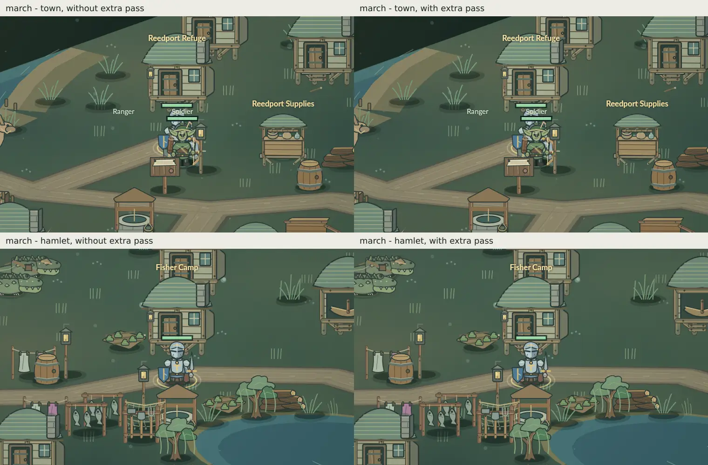
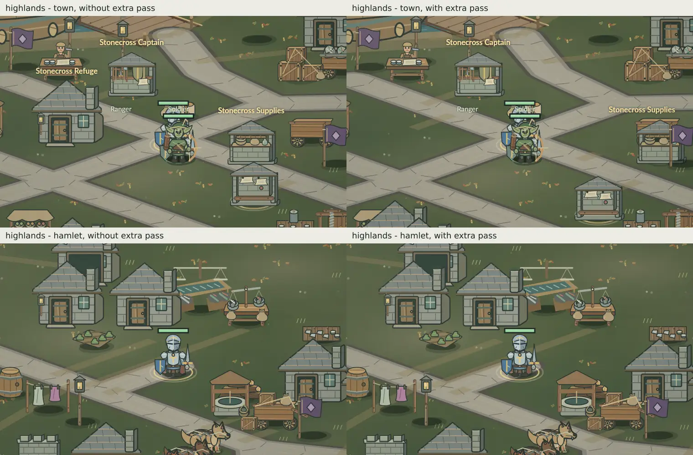
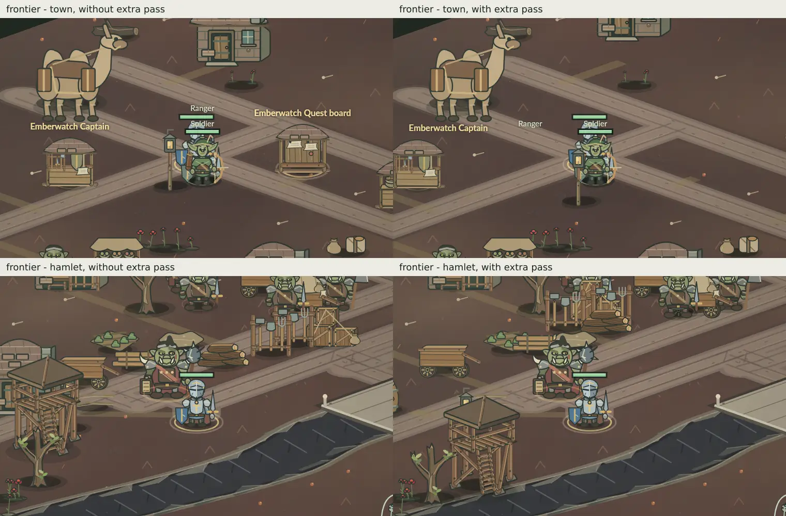
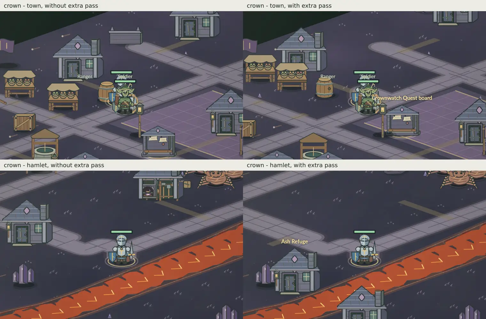

# Cross-region roads and placements — owner-triggered rollback investigation

**29 October 2026 · dated implementation audit and provisional draft rollback evidence.** This record exists because the owner rejected the dev.233 Greenwood environmental result and requested exact **before/after accountability for roads and moved objects in other regions**. It is not a new worldbuilding commission, a claim that every old road was good, or an accepted redesign.

**Official game:** *So I Became the Dark Lord's Problem*. **Scope:** Flooded Marches (`march`), Ironroot Highlands (`highlands`), Ashen Frontier (`frontier`) and Dark Crown (`crown`). Greenwood (`vale`) is handled separately by the owner's environment rollback/redesign. **Status:** source-level before/after checked, surgical rollback **implemented as an unmerged draft candidate**; visual and save-state before/after measurements, focused validation, merge, publication and owner device review **not completed**.

## Pinned provenance and adjacent work

- **Before:** immediately pre-Greenwood `main@87792f6441c8b01b3afd25282a209b695427f649`, the first parent of the [merged PR #570 / merge `323bb2a7`](https://github.com/joedoragon-glitch/azeroth-chronicles-prototype/commit/323bb2a75ceec9bafa8dfe9d567be057309a0115). Earlier pre-flagship Greenwood-only recovery source `c55faef3` is a separate checkpoint, **not** an appropriate wholesale baseline for independently updated other regions.
- **After:** dev.233 source introduced by #570 at merge `323bb2a7`. Current starting `main@0feb0e420a4ecf9192e996a42fdc9c2de5586264` includes later documentation and Barracks changes. The comparison from merge to this main head shows **no later edits to `src/prototype/world.js` or `src/prototype/highlands.js`**. Do not confuse unrelated subsequent merges with this road/placement intervention.
- **Parallel draft [#626](https://github.com/joedoragon-glitch/azeroth-chronicles-prototype/pull/626)** investigated inherited road/site regressions and remains **unmerged**. Some same repair families were subsequently included in the merged #570 source; avoid reverting #626 as if it separately shipped.
- **Parallel Greenwood-only draft [#648](https://github.com/joedoragon-glitch/azeroth-chronicles-prototype/pull/648)** is a separate 2700-layout rollback, not a reverse of these non-Greenwood road/placement effects. Never overwrite or merge that branch as part of this work.
- Original red tests / later green tests and changing interpretations are preserved in [#613](https://github.com/joedoragon-glitch/azeroth-chronicles-prototype/issues/613). A green assertion about all roads being connected does **not** constitute environmental/visual owner acceptance.

## Before → after → candidate: source-based change ledger

| Region / behavior | Before #570 (`87792f64`) | Introduced by #570 and present in `0feb0e42` | Current draft decision |
| --- | --- | --- | --- |
| **All four non-Greenwood regions: generic automatic network completion** | One normal `clearStreetCorridors(z)` pass for authored road safety; **no additional global final pass that iteratively joins every disconnected road**. | `clearStreetCorridors(z, true)` is invoked after regional composition on initial generation and on subsequent zone processing. It can route new joining links to every disconnected component, regardless of whether the previous road grouping was intentionally distinct. | **Disable the two late global invocations in this draft.** Preserve original road geometry and targeted regional remedies. The `finalPass` implementation remains in the file temporarily for audit/reversibility; do not call it implicitly. |
| **All four: service/refuge/building/prop displacement by global final pass** | Existing baseline clearance can move real obstacles off authored roads. No second region-wide placement sweep after completed regional composition. | Final pass can move historical Barracks, `rest`, `minor`, `board`, `supplier`, `recruiter`, and any roadside prop selected by its full-width setback, including a region-wide grid fallback. It stores revised Frontier/Crown service placements. | **Disable additional generic displacement**, not the original clearance or legitimate local repairs. Must inspect existing saved-game positions before reversing persisted changes. |
| **Flooded Marches: Reedport town approach** | Town center at **(350,1100)**; existing coastal network begins at **(350,1370)** without this explicit connecting segment. | `marchTownRoadLink` adds **(350,1100) → (350,1370)** if missing, to make a town-to-coast approach. | **Retain provisionally** as a geographically specific access repair, pending route and 150%-camera observation. Do not mistake one sensible approach for permission to connect all unrelated roads. |
| **Flooded Marches: coastal decoration near carriageways** | Shore props could occupy the narrower original 58-unit clearance, despite some art requiring at least 72. | `marchCoastalFinalClearance` moves only IDs starting `lantern-coast-` that actually violate `roadSetback`, with versioned one-time migration. | **Retain provisionally** as a targeted obstruction repair; verify resulting visual arrangement and old-save object identity. |
| **Ironroot: Treasury exterior** | Authored Treasury at **(1920,330)**, reported coincident with a road endpoint. | Anchor changed to **(2170,330)**; `highlandsTreasuryFrontage` chooses one of explicit legal exterior locations for older saved entrances when necessary. Interior/save identity remains. | **Retain provisionally**: a roof over the public carriageway is a real concern. Verify doorway and route, not just center distance. |
| **Ironroot: Quarry hamlet access** | Canonical minor center **(2520,510)**, nearby road ending at **(2520,650)**. | `highlandsQuarryRoadAccess` adds that **140-unit** spur and may move the refuge and any obstructing roofs affected by it. | **Separate review** of actual access need and its displaced roofs; retain if physically useful and compositionally coherent, otherwise propose a specific alternative, not a general road sweep. |
| **Ironroot: ogre habitat relocation** | Legacy generic habitat props around **(1980,1820)**; named ogre center already authored elsewhere. | `highlandsOgreHabitatFrontage` translates eligible `world-life-habitat-` props toward the authored ogre center near **(940,3010)** while retaining IDs. | **Visual review required**: this is a regional compound relocation, not intrinsically justified by a road collision. Do not silently roll it back or approve it. |
| **Ironroot: after-layout roadside move sweep** | Earlier Appalachian placement and road safety rules without the new versioned full-width post-layout scan. | `highlandsFinalRoadsideClearance` can reposition any non-`roadTrace` prop within its legal road setback and marks a saved migration receipt. | **Keep under review**, because actual carriageway obstructions are legitimate fixes; obtain per-ID old/new positions for any moved defenses, walls, trees or work props. |
| **Frontier and Crown: final network and town services** | Independently authored routes and service placements plus established normal clearance. | Global final pass may add multiple connectors, move props/buildings/NPC services and record `frontierTownPlacements` or `crownTownPlacements` for subsequent refresh. | **Disable generic late pass**; preserve existing authored layouts and legitimate prior corrections. Do not erase saved placements until original positions can be restored safely. |

**Important evidence limit:** The coordinates above are **source anchors and declared segment endpoints**, not an exhaustive count of realized road links or actual moved-object coordinates on a seeded world or an older v4 save. No representative before/after screenshots, route overlays, object-by-object movement CSV or device playtest are yet available from this draft; those must be produced before merge. Do **not** invent a count or describe all moved objects as defects.

## Conservative implementation boundary for the draft

This draft removes only the **two invocations** of `this.clearStreetCorridors(z, true)` in `src/prototype/world.js`. It leaves the old `this.clearStreetCorridors(z)`, targeted Treasury/Quarry/Marches repairs, Ironroot-specific routines, region authored data, quest and combat code, saved IDs and all other regions' creative contracts intact. The now-unused generic `finalPass` source is intentionally retained during inspection to keep the original behavior auditable; remove/refactor only after the owner accepts the selective scope.

**Do not assume a code-side disablement reverses already-saved changes.** The merged release may have persisted extra `z.roads`, moved NPCs, player buildings, scenery and version markers (`finalStreetClearanceVersion`, regional migration receipts, `frontierTownPlacements`, `crownTownPlacements`). A safe rollback needs an exact-old/new per-ID and per-road comparison. Never delete player-built structures, undo genuine Treasury clearances, reset a region, erase v4 progress, or blindly clear version markers. If an old or post-dev.233 save has no reliable per-object provenance, keep its positions and disclose the limitation rather than fabricating inverse coordinates.

## Native rendered comparison — one seeded world per region (29 October 2026)

**Measured, not inferred:** The original [focused CI #40967241998](https://github.com/joedoragon-glitch/azeroth-chronicles-prototype/actions/runs/40967241998) executed `tests/regional-street-rollback-audit.test.cjs` on the source candidate `0fa91a8a`. It rendered four **native Canvas gameplay** views per region at **150% zoom**: town and hamlet with the additional global pass **disabled** (left), versus the same objects after explicitly forcing `clearStreetCorridors(z, true)` once (right). The corresponding exact-ID movement/road data is [retained in a machine-readable evidence record](evidence/regional-street-rollback-20261029/seeded-spatial-deltas.json). These are matched candidate-state simulations, **not** actual pre-#570 checkout screenshots; visual judgment is independent of the old test's connectivity requirement.

| Region | Roads before→forced extra | Added road polylines | Prop moves | Service moves | Player building moves |
| --- | ---: | ---: | ---: | ---: | ---: |
| march | 13 → 13 | 0 | 0 | 0 | 0 |
| highlands | 13 → 13 | 0 | 0 | 3 | 0 |
| frontier | 41 → 41 | 0 | 86 | 4 | 0 |
| crown | 30 → 34 | 4 | 36 | 4 | 0 |

**Visual inspection and engineering disposition:**

- **Flooded Marches:** No added roads or object moves from the *additional global pass* on this seed. The Reedport-to-coast short link and named coastal clearance were already present in both views and remain separately subject to route judgment.
- **Ironroot Highlands:** Global pass relocates supplier (85 units), board (55), and **Stonecross refuge 463.82** units. The town comparison shows the refuge building disappearing from its prior neighborhood, an unacceptable change without proof that it cannot remain nearby. However the original strict street audit on candidate fails `highlands rest must stand beside a street, not in it`. **The necessary physical-clearance fix is outstanding; don't accept a broad displacement as the only solution.**
- **Ashen Frontier:** No road polyline added, but **86 props + four service NPCs** moved, including settlement and defensive props and a building-like watch structure in the hamlet scene. The town quest-board changes its visual relationship to the square. This is tangible unapproved layout churn in an already authored region.
- **Dark Crown:** **Four new road segments**, with endpoints and lengths in JSON; **36 props + four service NPCs** moved. Several houses travel 400–1,086 units; shown Crown town and lava-side hamlet arrangements differ substantially. This broad re-composition is not justified solely by the wish to connect every road component.

**Render evidence (left = candidate without extra sweep; right = explicit forced extra sweep):**

### Flooded Marches

### Ironroot Highlands

### Ashen Frontier

### Dark Crown

**Readiness:** This is a first real native visual pass, **not** a complete visual certification. Original merged-PR comparison, additional seeds, post-dev.233 v4 saves and after-reload shots are still required. The candidate is currently **not** merge-ready because the original Highlands road/service clearance assertion fails. Keep specific legitimate repairs and resolve this narrowly; do not relax the strict obstruction contract to suppress a real defect.

## Independent strict road-safety classification — 29 October 2026

[Focused PR run #40968257242](https://github.com/joedoragon-glitch/azeroth-chronicles-prototype/actions/runs/40968257242) also executed the separate, **non-mutating** `tests/regional-street-safety-audit.test.cjs`, using another deterministic fresh normal-mode seed per outdoor region. This test **did not waive the original street test**, did not alter gameplay geometry and recorded native road segments, full artwork setback, `roadBlocker` props, NPC service setbacks and player buildings separately. Its diagnostic completed; the overall PR CI remained **red** because the original `town-street-audit.test.cjs` reported Highlands refuge clearance.

| Region | Town-connected roads | Road segments failing `clearSegment` | Props inside full visual setback | Of those, explicitly `roadBlocker` | Service NPCs too close |
| --- | ---: | ---: | ---: | ---: | ---: |
| Marches | 13 / 13 | 0 | 0 | 0 | 0 |
| Highlands | 13 / 13 | 0 | 0 | 0 | 3 |
| Frontier | 41 / 41 | **2** | 86 | 11 | 4 |
| Crown | 0 / 30 from main-square origin | **1** | 34 | 14 | 3 |

**What these numbers do — and do not — show:** `clearSegment` is an actual navigation/collision check. These three failures and the explicit roof/service encroachments cannot be disregarded merely because the extra finalizer aesthetically rearranges the town. Conversely, **full artwork setback is not synonymous with an impassable road**: an overhanging roof, a decorative prop on the shoulder, and a collision-blocking wall require different remedies. An unconnected historical road component is also not automatically an inaccessible destination. The Crown `0/30` result means the canonical square is not on the raw original road network, **not** that the player can traverse zero roads. Confirm actual `route()` access to authored towns/dungeons and destinations separately.

**Highlands exact service values at candidate start:** refuge `(620,2255)` road distance **75 vs required 190**, supplier `(865,2145)` **35 vs 92**, board `(980,2255)` **75 vs 95**. The additional conservative, nearest-first **20-unit placement-grid diagnostic** reported **no fully legal refuge candidate** within its 420-unit search neighborhood after accounting for all current props/NPCs/terrain/buildings/creature homes and district radius. This is a failure of that *particular constrained search*, **not** proof no local solution exists. Moving the refuge 463.82 units under the global sweep would solve its measured setback but visibly remove it from the existing Stonecross town grouping. Preserve the real access requirement and find a scene-aware local arrangement rather than relaxing road collision or flattening the surrounding district.

**Safety disposition:** the two-call rollback is still a **research candidate, not a release candidate**. A correct final patch needs to (a) preserve meaningful road traversal and collision clearance; (b) solve measured local service/roof conflicts with the smallest necessary authored edits; (c) avoid compulsory joining of unrelated side paths and high-volume scenery relocation; and (d) handle historical persisted positions explicitly. The owner has authorized genuine fixes, **not** blanket reversal of protective source. Do not merge this red candidate, publish it, or certify it by screenshots alone.

## Required evidence before this PR could merge

1. On exact pinned pre-#570 source, shipped dev.233 source, and this draft candidate, capture **fresh seeded** non-Greenwood worlds plus representative v4 restored worlds. Enumerate every road polyline and every changed `props`, `buildings`, `npcs` object by ID, with *before (x,y), after (x,y), reason, and restoration status*. Report new links by endpoints and length. Do not compare only raw map design constants or only screenshots.
2. Review 150%-camera **real render** overlays around Reedport, the Ironroot Treasury, Quarry hamlet, ogre settlement, all major Frontier and Crown service squares, and any added road intersection or moved wall/house. Mark actual obstruction vs unintended composition. A strict pass can be a real repair, an overbroad test premise, or both.
3. Preserve truly necessary approaches/clearances; explicitly list and reverse only unjustified connections and their *caused* displacements. Reconcile historical v4 and repeat-save behavior. Do not move buildings just to accommodate an unnecessary new road.
4. Execute the **smallest relevant original** street/region/site/save regression suites and reproducible build on the **exact final candidate**, retaining any failures and their source-based explanation; no broad test or browser certification is authorized here. The global all-roads-connected assertion may now fail; do not silently weaken it, but distinguish traversal safety from enforced single-network aesthetics. Resolve independently before an approval claim.
5. Reconcile source version/build/service worker and affected maintained docs **in the same final code change**. This draft is **not release-ready** while versioned build artifacts and exact candidate verification are absent. Do not merge or deploy without a fresh owner decision; main pushes can publish automatically.

**CI diagnosis (first draft run):** [PR run #40966373949](https://github.com/joedoragon-glitch/azeroth-chronicles-prototype/actions/runs/40966373949) failed its documentation gate because the new audit was an *added* file, not an update to an existing feature guide. Runtime suites/build did **not** execute. The existing world-proportion/space guardrails now include the owner's actual physical-road versus automatic-connectivity rule; this is a relevant maintained feature-document update, not a waiver. Recheck the next exact-head focused run before changing test assertions.

## Actual native before/after evidence — first seeded review (29 October)

**Source/test provenance:** [Focused run #40967241998](https://github.com/joedoragon-glitch/azeroth-chronicles-prototype/actions/runs/40967241998) at integration checkout `a9497f714e2760b182005e4ad94230818c80642b` (draft feature `0fa91a8a` against main after Greenwood recovery `fcc1f428`). The test invokes the exact formerly released `clearStreetCorridors(z,true)` manually on **the same freshly generated Campaign** after capturing the candidate's normal source state. It records every added road and NPC/prop/building displacement from that *one extra pass*, then uses the actual native Canvas renderer at 150% camera zoom for paired town/hamlet scenes. This is not every historical source edit; no real player v4 campaign or installed phone was inspected.

| Region | Roads without → with extra pass | Added segments | Moved props | Moved NPCs | Moved player buildings |
| --- | --- | ---: | ---: | ---: | ---: |
| `march` | 13 → 13 | 0 | 0 | 0 | 0 |
| `highlands` | 13 → 13 | 0 | 0 | 3 | 0 |
| `frontier` | 41 → 41 | 0 | 86 | 4 | 0 |
| `crown` | 30 → 34 | 4 | 36 | 4 | 0 |

**Independent visual/source interpretation:** March shows no change from this extra pass (the targeted Reedport and shoreline repairs are separate). Highlands moves three town services, including the `rest` NPC **463.82 units**; the original strict street audit on this candidate reports the unchanged refuge violates a road-side clearance, so a *targeted* repair is necessary. Frontier moves **86 props and four services without adding a road**, including noticeable hamlet structures/defenses. Crown adds **four connecting segments** and moves **36 props plus four services**, with at least one house moved **1,086.65 units**. The Crown visual pairs show substantial dislocation of the residential arrangement. These are grounded reasons to reject the blanket automatic completion/displacement pass, not claims that every moved decorative object was individually unacceptable.

**CI boundary:** this native comparison passed, but the overall original run **failed**: `tests/sprite-scope.test.cjs` correctly requires updating the reviewed `world.js` source fingerprint, and the original `tests/town-street-audit.test.cjs` fails at `highlands rest must stand beside a street, not in it`. Neither failure has been waived or called green. This PR is still **not merge-ready**, and old v4 saved placements have not been reversed or proven safe.

**Checkpoint:** Source scope classified and draft two-call rollback candidate created. **Not tested**, not merged, not published, not device-verified. Preserve both the rejected dev.233 reference and the owner's independent Greenwood rollback/redesign work.
